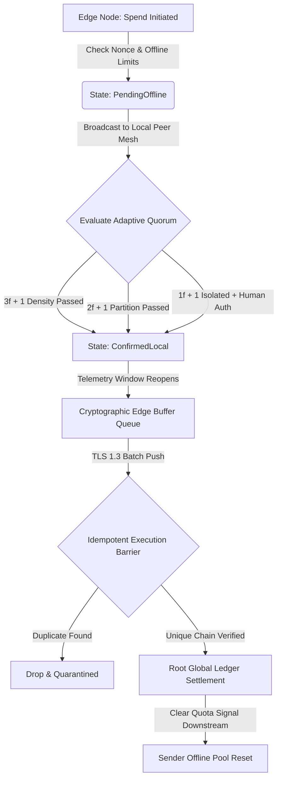

# yodpay-core
Offline-first payment core for Gideon Mesh – Rust + C++
# YODPAY Core

Offline-first payments that keep working when the network fails.

YODPAY is the first product of **Gideon Mesh** — an edge-first architecture designed for partitioned and constrained environments.

This repository contains a complete working implementation of the YODPAY protocol core in both **Rust** and **C++**.

---

## What this core already does

- Offline spending limits (tiered risk profiles)
- Adaptive local consensus modes:
  - `3f+1` (Normal)
  - `2f+1` (Partitioned)
  - `1f+1` (Extreme isolation)
- Local finality while offline
- Double-spend protection via sequential nonces
- Full transaction lifecycle:  
  `PendingOffline` → `ConfirmedLocal` → `Settled`

---

## Project Structure---

## Current Status

This is a **working protocol foundation**, not a production payment system yet.

### Already implemented
- Core offline payment logic
- Adaptive quorum
- Risk limits
- Double-spend protection
- Transaction state machine

### Still required for production
1. Database persistence
2. Real mesh / local networking
3. Cryptographic signatures (ed25519)
4. Human cryptographic approval in extreme (`1f+1`) mode

---

## Why this exists

Most payment systems assume a permanent connection to central servers.  
In many places the network or power regularly fails.  

YODPAY is built so devices can still confirm value transfer locally and safely, then reconcile when connectivity returns.

---

## Founder

**Sibongakonke Masondo**  
Systems Architect & Founder, Gideon Mesh  
20 · South Africa

---

## License

Currently for demonstration and evaluation purposes.  
Contact for any commercial or partnership use.
